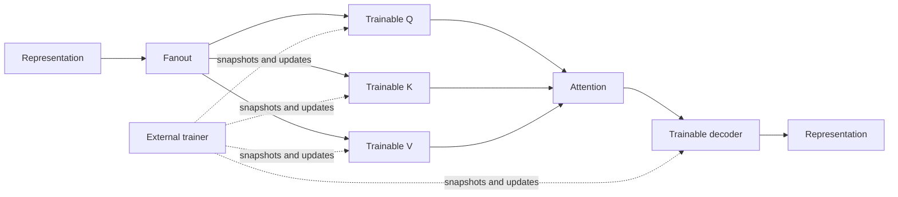

# Learnable processing chain (initial core integration)

This is an **opt-in topology composition**, not a replacement for `DefaultTopology`.
It introduces trainable linear projection/decoder nodes with recorded forward passes and
revision-checked parameter replacement. It deliberately does not import the playpen's
outdoor-light experiment, replay selectors, confidence objectives, or signal-specific labels.

`LearnableProcessingChain` exposes ordinary `Node` instances, an input and output
`Port<Representation>`, so its nodes can be passed to `DefaultTopology(nodes = ...)` and
its input connected to an existing `SampleEntryPoint.output`. The topology does not
automatically attach a trainer or alter how Samples are sensed.

Each `TrainableProjectionNode` accepts a fixed-shape `LinearParameters` (weights and bias),
produces a position-wise linear output and an inspectable `LinearForwardPass`, and
exposes `snapshotRequests`, `parameterSnapshots`, `parameterUpdates`, and `updateResults`. The recorded
pass retains the exact input, output, parameter snapshot and revision, and can compute a
vector-Jacobian product via `backward(outputGradient)`. The result contains input,
weight and bias gradients. Arrays are copied at the public boundary.

The `RecordedAttentionNode` also emits an `AttentionForwardPass` with the actual
softmax weights. Its analytic `backward` yields query, key and value gradients. A trainer
can compose the decoder VJP, attention VJP and three projection VJPs to propagate a
loss through the full chain. This derivative is intentionally restricted to
`ScaledDotProductAttention`, not arbitrary plug-in attention implementations.

`RecordedAttentionNode` deliberately emits the attention `Representation` first and its
corresponding `AttentionForwardPass` second. These are **independent port deliveries**,
not an atomic pair. A downstream node requiring both must retain its inputs and process
only when both have arrived, regardless of their arrival order. In an isolated
synchronous execution, the pass's `output` is the same representation object sent on
the attention port. The current topology provides **no execution correlation guarantee**
for overlapping or asynchronously delivered executions; consumers must not assume
that arbitrary outstanding values belong to the same forward pass.

An external trainer may compute its own objective/learning rate, use
`LinearParameters.descend(gradients, learningRate)`, then submit
`LinearParameterUpdate(expectedRevision, newParameters)`. A stale revision or a shape
mismatch is **consumed and rejected without throwing**, leaving the current parameters and
revision unchanged. The `updateResults` output emits `Applied(expectedRevision, currentRevision)`
or `Rejected(expectedRevision, currentRevision, reason)`; rejection reasons distinguish
`STALE_REVISION` and `INVALID_SHAPE`. A trainer observing this port decides whether
to discard the obsolete gradient or compute a fresh one. As with other `SingleSlotPort`
outputs, a connected result consumer must drain its port before the next result.
Neither the node nor `DefaultTopology` decides how/when to train. Frozen evaluation can simply omit parameter updates.

### Representation backends

The chain's public ports and recorded passes use the `Representation` interface. Its current linear,
attention and analytic backward operations read numeric `Embedding` values and produce
`NumericRepresentation` outputs/gradients. Accepting an alternative implementation does not make
these operations part of its autograd graph. The fanout and identity projection preserve object
identity, while numeric neural operations create new numeric results as before.

Forward passes retain input references, not owned backend snapshots. A caller supplying a backend
with a bounded lifetime or mutable aliases must keep inputs valid and stable through backward.
This PR adds no copying policy, backend bridge, lifetime manager or scheduling mechanism. See
[Representation compatibility](representation-compatibility.md).

### Current limit and next validation

The chain supports an **analytical end-to-end gradient path** for one recorded forward pass,
including Q/K/V and decoder. It does not include a built-in loss, supervised target resolver,
optimizer, experience memory, replay schedule or automatic update of parameters. The
`Trainer` contract remains independent: it is responsible for selecting actual targets,
computing output gradients and issuing revision-checked updates. This PR does not claim
that any learned forecast generalizes. Tests cover gradient propagation and compare
attention derivatives with centered finite differences.

Before promoting learned binary semantics, confidence gating, retention quotas or replay
policies, reproduce improvements on multiple seeds and signal identities, including
unseen identifiers, matched optimization budgets, per-horizon routing coverage and
frozen no-update evaluation. See the [playpen PR21 findings](https://github.com/skasti/vaettr-playpen/blob/main/docs/pr21-findings.md).

This opt-in design follows [Architecture](architecture.md), [Default topology](default-topology.md)
and [Sensory representation](sensory-representation.md). It does not change `Signal`,
`SignalId`, `Sample` or `Prediction` contracts.
