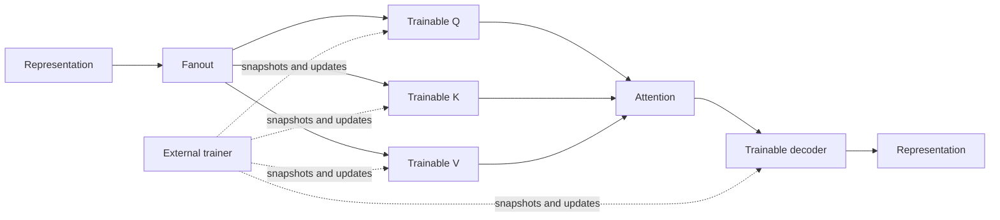

# Learnable processing chain (initial core integration)

This is an **opt-in topology composition**, not a replacement for `DefaultTopology`.
It introduces trainable linear projection/decoder nodes with recorded forward passes and
revision-checked parameter replacement. It deliberately does not import the playpen's
outdoor-light experiment, replay selectors, confidence objectives, or signal-specific labels.

`LearnableProcessingChain` exposes ordinary `Node` instances, an input and output
`Port<Representation>`, so its nodes can be passed to `DefaultTopology(nodes = ...)` and
its input connected to an existing `SampleEntryPoint.output`. The topology does not
automatically attach a trainer or alter how Samples are sensed.

Each `TrainableLinearNode` accepts a fixed-shape `LinearParameters` (weights and bias),
produces a position-wise linear output and an inspectable `LinearForwardPass`, and
exposes `snapshotRequests`, `parameterSnapshots`, and `parameterUpdates`. The recorded
pass retains the exact input, output, parameter snapshot and revision, and can compute a
vector-Jacobian product via `backward(outputGradient)`. The result contains input,
weight and bias gradients. Arrays are copied at the public boundary.

The `RecordedAttentionNode` also emits an `AttentionForwardPass` with the actual\nsoftmax weights. Its analytic `backward` yields query, key and value gradients. A trainer\ncan compose the decoder VJP, attention VJP and three projection VJPs to propagate a\nloss through the full chain. This derivative is intentionally restricted to\n`ScaledDotProductAttention`, not arbitrary plug-in attention implementations.\n\nAn external trainer may compute its own objective/learning rate, use
`LinearParameters.descend(gradients, learningRate)`, then submit
`LinearParameterUpdate(expectedRevision, newParameters)`. A stale revision or a shape
change is rejected, and neither the node nor `DefaultTopology` decides how/when to
train. Frozen evaluation can simply omit parameter updates.

### Current limit and next validation

The chain supports an **analytical end-to-end gradient path** for one recorded forward pass,
including Q/K/V and decoder. It does not include a built-in loss, supervised target resolver,
optimizer, experience memory, replay schedule or automatic update of parameters. The
`Trainer` contract remains independent: it is responsible for selecting actual targets,
computing output gradients and issuing revision-checked updates. This PR does not claim
that any learned forecast generalizes. Tests cover gradient propagation and compare
attention derivatives with centered finite differences.

Before promoting learned binary semantics, confidence gating, retention quotas or replay
policies, reproduce improvements on multiple seeds and signal identities, including
unseen identifiers, matched optimization budgets, per-horizon routing coverage and
frozen no-update evaluation. See the [playpen PR21 findings](https://github.com/skasti/vaettr-playpen/blob/main/docs/pr21-findings.md).

This opt-in design follows [Architecture](architecture.md), [Default topology](default-topology.md)
and [Sensory representation](sensory-representation.md). It does not change `Signal`,
`SignalId`, `Sample` or `Prediction` contracts.
